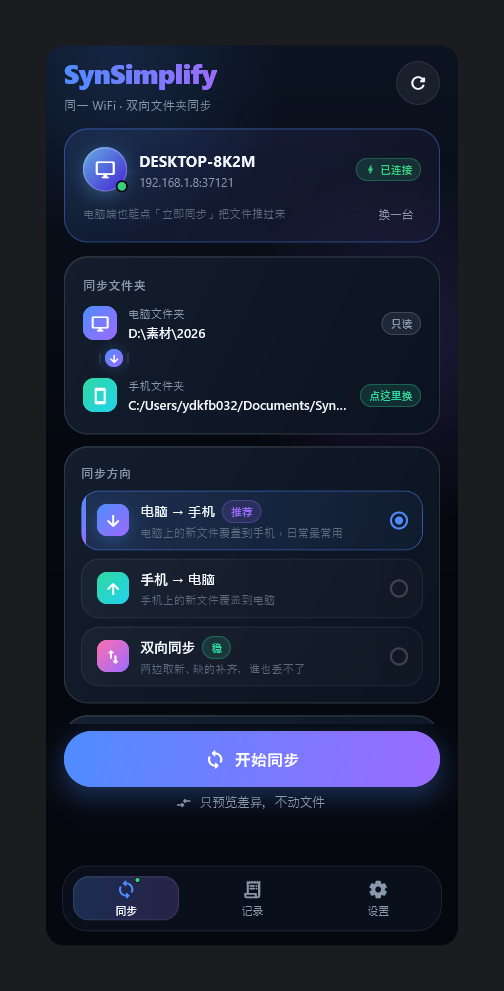
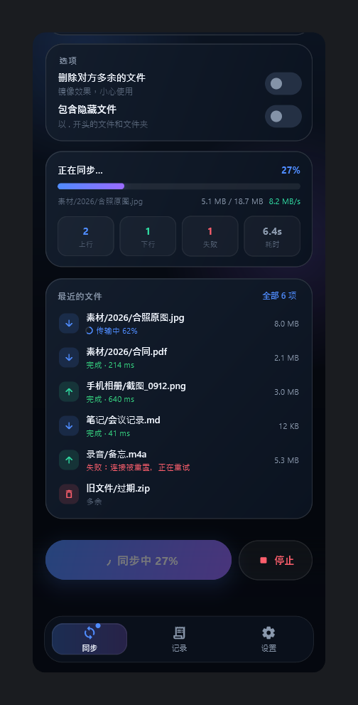

# SynSimplify · 简同步

> 同一个 WiFi 下，把**电脑和手机的两个文件夹同步成一模一样**。不注册账号、不上传云端、不走流量。

---

## 这东西是干什么用的

平时把手机里的东西弄到电脑上，一般只有这几条路：插数据线、微信文件传输助手、网盘、或者一遍遍手动拖拽。
它们要么慢，要么压缩画质，要么得先把文件传到别人服务器上转一圈。

**SynSimplify 解决的就是这一件事**：只要手机和电脑连的是同一个路由器，打开两端的程序，它们会自己找到对方，
然后把你指定的两个文件夹（比如「电脑 `D:\素材\2026`」和「手机 `内部存储/SynSimplify`」）的内容对齐 ——
新增的补上、改过的覆盖、删掉的按你的选择处理。

典型用法：

- 电脑上整理好的照片 / 文档，一键推到手机，随时看；
- 手机拍的照片、录的音、下载的文件，回到电脑自动收进素材库；
- 两边都改，用「双向同步」取新的、补缺的。

数据全程在局域网内点对点传输，**没有账号、没有云端、没有中转服务器**，断网也能用（只要两台设备还在同一个路由器下）。

---

## 界面

手机端空闲状态 —— 自动发现到电脑后显示设备名、IP、两端文件夹和同步方向：



同步进行中 —— 实时进度、上下行数量、失败重试、逐文件明细：



---

## 它是怎么工作的

```
┌──────────────┐        UDP 37120 广播：SYNSIMPLIFY/DISCOVER        ┌──────────────┐
│  手机 App    │ ───────────────────────────────────────────────▶ │  电脑端 Host │
│  (Flutter)   │ ◀─────────────────────────────────────────────── │   (Python)   │
└──────┬───────┘        UDP 37120 应答：地址 / 端口 / 文件夹         └──────┬───────┘
       │                                                                   │
       │            HTTP 37121+ ：列目录、比哈希、上传 / 下载              │
       └───────────────────────────────────────────────────────────────────┘
```

1. **自动发现（双向）**：手机每 0.6~1.5 秒在局域网内广播一次，电脑收到就回自己的地址、端口、同步目录；
   电脑这边同时也在主动广播，**逐张网卡绑源地址发**，所以插着网线也不影响 WiFi 那侧的手机发现它。
   通常不用填任何 IP；同时在线多台电脑时才会让你选一台。
2. **先比对再传**：两端各自列出文件清单（相对路径、大小、修改时间），内容不同的再比对哈希，
   只传真正变了的文件，不会每次全量重拷。
3. **双向都能拉**：手机端也起了一个小型 HTTP 服务，所以「手机 → 电脑」和「双向同步」时，
   电脑可以直接来手机取文件，不需要手机主动推。
4. **失败可重试**：单个文件失败不影响其他文件，界面上会标出失败原因并可再次尝试。

---

## 两端程序

| | 手机端 | 电脑端 |
|---|---|---|
| 目录 | [`app/`](app) | [`host/`](host) |
| 技术 | Flutter (Android) | Python + tkinter（可打包成单文件 exe） |
| 安装包 | `app/dist/SynSimplify-v1.x.x-*.apk` | `host/dist/SynSimplify.exe` |
| 系统要求 | Android 8.0+ | Windows 10 / 11（Python 3.10+ 仅源码运行需要） |

---

## 下载

现成安装包在 [Releases](https://github.com/1772631792/SynSimplify/releases/latest) 页面：

| 文件 | 平台 | 说明 |
|---|---|---|
| `SynSimplify-v1.x.x-*.apk` | Android 8.0+ | 手机端，安装时需允许「未知来源」 |
| `SynSimplify-v1.x.x-win64.exe` | Windows 10 / 11 | 电脑端，单文件免安装，双击即用 |

也随仓库放在 `app/dist/` 与 `host/dist/` 下；想自己编译看下面的「从源码构建」。

---

## 快速开始

### 1. 电脑端

- **用现成的 exe**：双击 `SynSimplify.exe`（若 Windows 弹出防火墙提示，请允许**专用网络**访问）。
- **从源码跑**：

  ```bash
  cd host
  pip install -r requirements.txt
  python main.py            # 打开图形界面
  ```

  第一次启动会自动建一个干净的同步目录：`文档\SynSimplify`（不会一上来就同步整个用户目录）。
  界面上可以改成本机的任意文件夹，并选择同步方向。

### 2. 手机端

1. 安装 `app/dist/` 下的 APK（未上架应用商店，需要允许「安装未知来源应用」）。
2. 首次打开按提示授予**所有文件访问权限**（同步任意文件夹需要它，Android 11+ 会跳到系统设置页手动开启）。
3. 确保手机和电脑连的是**同一个 WiFi**（同一路由器；部分路由器的「访客网络 / AP 隔离」会挡住设备互访）。

### 3. 开始同步

手机端会自动搜到电脑并连上；选好两侧文件夹和同步方向，点底部「**同步**」即可。
同步过程中可以随时「停止」，已经传完的文件不会重来。

---

## 同步方向和选项

| 方向 | 含义 |
|---|---|
| **电脑 → 手机**（推荐） | 以电脑为准，电脑上的新文件覆盖到手机，日常最常用 |
| **手机 → 电脑** | 以手机为准，手机上的新文件覆盖到电脑 |
| **双向同步** | 两边取新的、缺的补齐，谁也不会丢 |

三个可选项：

- **删除对方多余的文件**：镜像模式。手机上没有、电脑上有的文件，同步后会被删掉，**效果狠，慎用**。
- **包含隐藏文件**：以 `.` 开头的文件和文件夹（如 `.git`、`.nomedia`）默认跳过，勾选后一起同步。
- **只从 WiFi 找设备**：电脑同时插着网线、又连着 WiFi 时勾上，广播只从无线网卡发出（原因见下面的常见问题）。

---

## 命令行用法（电脑端）

不需要图形界面时可以直接用命令行，适合脚本 / 定时任务：

```bash
python main.py --no-gui                                  # 只跑服务，看日志
python main.py --sync 192.168.1.8:37131 --mode push      # 直连某台手机同步一次
python main.py --scan                                    # 扫当前网段找手机（不走广播）
python main.py --selftest                                # 自检：本地起两套服务互相同步，跑完退出
```

手机端如果搜不到电脑，也可以在「设置」里手动填写电脑的 IP 和端口（默认 `37121`）。

---

## 从源码构建

### 手机端 APK

```bash
cd app
python build.py                 # 画图标 → 写 Gradle 代理 → flutter build apk --release
python build.py --proxy ""      # 不用代理（默认走 127.0.0.1:7897）
python build.py --split-abi     # 按 ABI 分包，单包体积更小
```

产物：`app/build/app/outputs/flutter-apk/app-release.apk`，脚本会自动复制一份到
`app/dist/SynSimplify-v{版本}-{日期}.apk`。

### 电脑端 EXE

```bash
cd host
python build.py                 # PyInstaller 单文件打包，自动生成 .ico
python build.py --proxy ""      # 不用代理
```

产物：`host/dist/SynSimplify.exe`（单文件，双击即用，无需装 Python）。

### 发布新版本

1. 改两个版本号：`app/pubspec.yaml` 的 `version:` 和 `host/config.py` 的 `APP_VER`；
2. 分别执行上面两个 `build.py`；
3. 把 `app/dist/*.apk` 和 `host/dist/SynSimplify.exe` 作为附件上传到 GitHub Release。

本仓库当前版本：**v1.0.3**（2026-11-23，界面改版：同步页不再被按钮遮挡、电脑端圆角卡片与大按钮）。

---

## 常见问题

**手机搜不到电脑？**
确认两端在同一网段（手机 WiFi 设置的 IP 和电脑 `ipconfig` 的 IPv4 前三段一致）；关掉路由器上的「AP 隔离 / 访客网络」；
Windows 防火墙放行 `SynSimplify.exe` 的专用网络；实在不行在手机「设置」里手动填电脑 IP。

**怎么判断是「广播没到」还是「连上了但被挡」？**
电脑端手机列表右上角有「**扫描本网络**」按钮：它不走广播，直接扫当前网段上手机的 `37131` 端口，
绕开路由器 AP 隔离对 UDP 广播的限制。也可以命令行跑：

```bash
python main.py --scan
```

它会把每张网卡、哪些无线没连 WiFi、扫到的手机一起列出来。三种结果对应三种问题：

| 现象 | 说明 |
|---|---|
| 扫到了手机 | 网络是通的，问题在广播 → 点一下「扫描本网络」直接连 |
| 没扫到，且手机 WiFi 的 IP 和电脑网卡不同段 | 两边不在同一网络（例如电脑在 `192.168.1.x`，手机在 `192.168.103.x`） |
| 没扫到，且 `netsh wlan show interfaces` 里电脑 State 是 disconnected | 电脑根本没连 WiFi，只有网线 |

底部状态栏也会提示：收到过手机广播却连不上，会写「收到 x.x.x.x 的广播但握手没成功」，那就是防火墙挡了 TCP 37121。

**电脑同时插着网线、又连着 WiFi，手机就找不到了？**
这是多网卡的老问题：广播走哪张网卡由系统路由表决定，默认常常是网线那张，于是 WiFi 这一侧的手机既收不到电脑的回复，
电脑也未必收得到手机发来的广播。v1.0.1 起电脑端会**主动逐个网卡广播自己**（每秒 1.5 次），WiFi 那张一定带上，
手机不用先出声也能发现电脑；勾上「选项 → 只从 WiFi 找设备」则只走无线网卡，网线完全不影响。
需要固定走 WiFi 又暂时没插网线的笔记本，保持默认「所有网卡」即可。

**电脑端提示发现端口 37120 打不开？**
多半是端口被别的程序占用或权限不足，这时手机的自动发现会失效，改用手机端手动填 IP 即可。

**传输速度上不去？**
走的是 WiFi 实际带宽，2.4G 频段通常只有 3~8 MB/s；连 5G 频段、靠近路由器会快很多。

**同步会不会把文件弄丢？**
默认不会删除任何东西，只有显式勾选「删除对方多余的文件」才会删；建议先用小文件夹试一次。

**能跨公网 / 4G 用吗？**
不能，设计上只做局域网直连，这样不需要服务器、也不需要担心数据出网。

---

## 目录结构

```
SynSimplify/
├─ app/                 # 手机端（Flutter，Android）
│  ├─ lib/              # 页面、状态、同步引擎、协议客户端
│  ├─ android/          # 原生权限、选文件夹、常亮
│  ├─ test/             # 同步逻辑单元测试
│  ├─ build.py          # 一键打包 APK
│  └─ dist/             # 打好的 APK
├─ host/                # 电脑端（Python + tkinter）
│  ├─ main.py           # 入口：GUI / 命令行 / 自检
│  ├─ discovery.py      # UDP 广播发现（被动应答 + 主动广播）
│  ├─ netinfo.py        # 枚举本机网卡，区分有线 / 无线
│  ├─ lanscan.py        # 扫网段 37131 端口找手机（广播被拦时的兜底）
│  ├─ server.py         # HTTP 服务（供手机拉取）
│  ├─ sync.py           # 同步引擎（比对、传输、重试）
│  ├─ ui.py             # 图形界面
│  ├─ build.py          # 一键打包 exe
│  └─ dist/             # 打好的 exe
├─ tools/make_icon.py   # 现画图标（渐变文件夹 + 双向箭头），两端共用
└─ ui_*.png             # 界面截图
```
